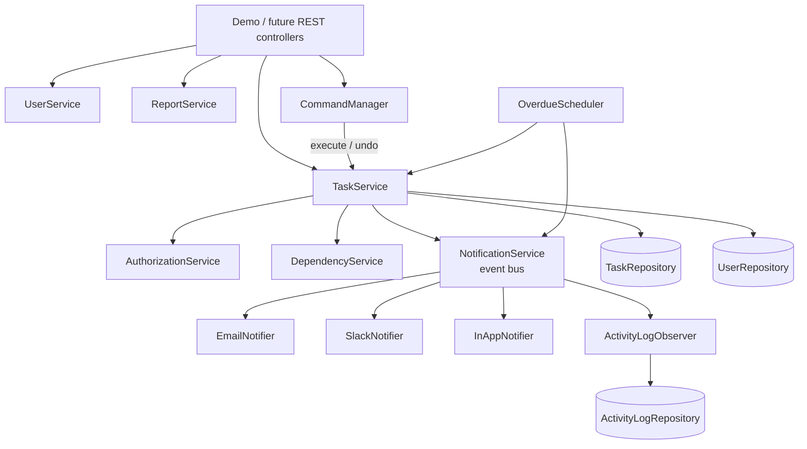
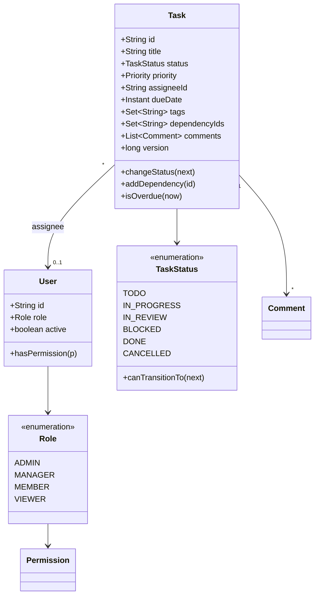
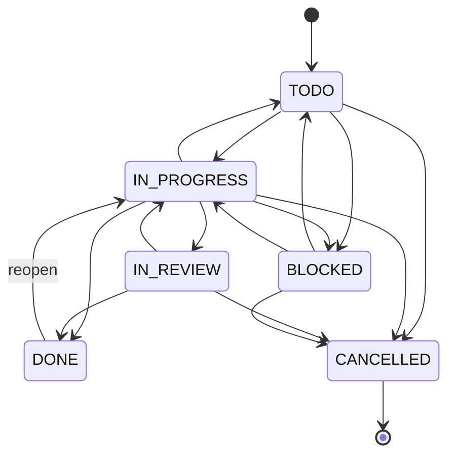

# Task Management System (Low-Level Design)

A Jira-style task manager built in plain Java to show how a real backend domain is designed: clean layers, design patterns used where they earn their place, business rules enforced in one spot each, and safe behaviour under concurrent writes. Storage is in-memory, so you can run it with no database or framework.

  

---

## Table of contents

1. [Features](#features)
2. [Quick start](#quick-start)
3. [Project structure](#project-structure)
4. [Architecture](#architecture)
5. [Design patterns](#design-patterns)
6. [Business rules](#business-rules)
7. [Concurrency model](#concurrency-model)
8. [Usage examples](#usage-examples)
9. [Demo output](#demo-output)
10. [Design decisions and trade-offs](#design-decisions-and-trade-offs)
11. [Extending the system](#extending-the-system)

---

## Features

| Area | What it does |
|------|--------------|
| **Tasks** | Create, assign, re-prioritise, set due dates, tag, comment, subtasks, delete |
| **Lifecycle** | Status state machine: `TODO -> IN_PROGRESS -> IN_REVIEW -> DONE`, plus `BLOCKED` and `CANCELLED`; `DONE` can be reopened |
| **Dependencies** | "A needs B first", cycle detection, topological execution order |
| **Access control** | Roles `ADMIN`, `MANAGER`, `MEMBER`, `VIEWER` with permissions, plus ownership checks |
| **Auto-assignment** | Pluggable: least-loaded or round-robin |
| **Search** | Filter by status, priority, assignee, tags, due date, keyword, overdue; pluggable sorting; pagination |
| **Undo / redo** | Command pattern with a bounded history |
| **Notifications** | Email, Slack, in-app inbox and audit log, each as an independent observer |
| **Overdue alerts** | Scheduler raises one alert per overdue task, no repeats |
| **Reports** | Counts by status and priority, overdue count, completion rate, open load per assignee |
| **Concurrency** | Optimistic locking with retry; no lost updates |

---

## Quick start

**Requirements:** JDK 17 or newer (the code uses records and pattern-matching `instanceof`).

### IntelliJ IDEA

1. Open the project and let Maven import.
2. Open `demo/TaskManagementDemo.java`.
3. Click the green arrow next to `main()`.

### Command line

```bash
./mvnw -q compile
java -cp target/classes com.TaskManageMentSystem.TaskManageMentSystem.demo.TaskManagementDemo
```

The demo wires everything together and walks through 12 scenarios, including the failure cases (each prints `[BLOCKED]` with the reason). It finishes with exit code 0.

---

## Project structure

```
src/main/java/com/TaskManageMentSystem/TaskManageMentSystem/
├── demo/            TaskManagementDemo           end-to-end walkthrough (composition root)
├── enums/           TaskStatus, Priority, Role, Permission, TaskEventType
├── model/           Task, User, Comment, ActivityLog, Notification
├── dto/             CreateTaskRequest, TaskFilter, PageRequest, Page, TaskEvent, TaskStats
├── exception/       TaskManagementException + 9 specific exceptions
├── repository/      TaskRepository, UserRepository, ActivityLogRepository + in-memory impls
├── strategy/        SortStrategy (4 impls), AssignmentStrategy (2 impls)
├── command/         TaskCommand, 3 commands, CommandManager
├── notificatioin/   TaskObserver, NotificationService, Email/Slack/InApp/ActivityLog observers
├── service/         TaskService, UserService, AuthorizationService,
│                    DependencyService, ReportService, OverdueScheduler
└── util/            IdGenerator, MutableClock, Preconditions
```

> The package name `notificatioin` keeps the original spelling. Rename it in IntelliJ with Shift+F6 if you like.

---

## Architecture



**Layers:** services depend on repository *interfaces*, never on storage. Observers depend only on `TaskEvent`. Nothing in `model` or `enums` knows about services.

### Core model



### Status state machine



### Roles and permissions

| Permission | ADMIN | MANAGER | MEMBER | VIEWER |
|---|:-:|:-:|:-:|:-:|
| `CREATE_TASK` | yes | yes | yes | |
| `ASSIGN_TASK` | yes | yes | | |
| `UPDATE_ANY_TASK` | yes | yes | | |
| `UPDATE_OWN_TASK` | yes | yes | yes | |
| `COMMENT` | yes | yes | yes | |
| `VIEW_REPORTS` | yes | yes | | |
| `DELETE_TASK` | yes | | | |
| `MANAGE_USERS` | yes | | | |

"Own" means the user is the assignee or the creator of the task.

---

## Design patterns

| Pattern | Where | Why |
|---------|-------|-----|
| **Observer** | `NotificationService` + `TaskObserver` implementations | Services publish one `TaskEvent`; email, Slack, inbox and audit log react independently. A new channel is one new class and zero edits to services. |
| **Strategy** | `SortStrategy`, `AssignmentStrategy` | Ordering and auto-assignment change without touching `TaskService`. |
| **Command** | `ChangeStatusCommand`, `ChangePriorityCommand`, `AssignTaskCommand`, `CommandManager` | Each action knows how to undo itself, which gives undo/redo for free. |
| **Builder** | `Task`, `CreateTaskRequest`, `TaskFilter` | Many optional fields without telescoping constructors; objects stay immutable or validated. |
| **State machine** | `TaskStatus` | Allowed transitions live next to the states, so the rule exists once. |
| **Repository** | `*Repository` interfaces | Swap in-memory for JPA or Mongo without changing services. |
| **Composite** | `CompositeSortStrategy` | Chain sorts: first decides, the rest break ties. |

---

## Business rules

1. **Status:** only transitions defined in `TaskStatus` are allowed (for example `TODO -> DONE` is rejected).
2. **Completion:** a task cannot be `DONE` while any dependency is not `DONE` or while it has open subtasks.
3. **Dependencies:** no self-dependency and no cycles (checked with an iterative DFS before saving).
4. **Authorization:** every command checks role permissions and, for edits, task ownership.
5. **Assignment:** only to active users; assigning someone else needs `ASSIGN_TASK`.
6. **Closed tasks** (`DONE` / `CANCELLED`) cannot change priority, due date or assignee until reopened.
7. **Due dates** must be in the future when set.
8. **Deletion:** admin only, and blocked if other tasks depend on the task or it has subtasks.
9. **Users:** e-mail is unique (case-insensitive).
10. **No self-notification:** people are never notified about their own actions.

---

## Concurrency model

The write path in `TaskService` is the same for every command:

```
load a fresh copy -> check rules -> mutate the copy -> save with version check
        ^                                                     |
        └───────── retry if another writer saved first ───────┘
                                          then publish the event
```

- `InMemoryTaskRepository` stores and returns **copies**, so callers cannot mutate stored state by accident.
- `Task.version` plus an atomic check-and-write inside `ConcurrentHashMap.compute` gives **optimistic locking**: a stale save throws `OptimisticLockException`.
- There are **no global locks**. Writers to different tasks never block each other.
- Events are published only **after** a successful save, so observers never see unsaved state.
- `NotificationService` accepts an `Executor`. The default runs observers synchronously (deterministic output); pass a thread pool for async delivery.
- A failing observer is caught and logged, and never breaks the business operation or other observers.

The demo proves it: 4 threads each add 5 comments to the same task, and all 20 are saved.

---

## Usage examples

### Wiring (composition root)

```java
MutableClock clock = new MutableClock(Instant.parse("2026-11-02T09:00:00Z"));
UserRepository userRepo = new InMemoryUserRepository();
TaskRepository taskRepo = new InMemoryTaskRepository();

NotificationService notifications = new NotificationService();
notifications.subscribe(new ActivityLogObserver(new InMemoryActivityLogRepository()));
notifications.subscribe(TaskEventType.ASSIGNED, new EmailNotifier(userRepo));
notifications.subscribe(new SlackNotifier("#critical-alerts"));

AuthorizationService auth = new AuthorizationService();
TaskService tasks = new TaskService(taskRepo, userRepo, auth,
        new DependencyService(taskRepo), notifications, clock);
```

### Create and move a task

```java
Task t = tasks.createTask(managerId, CreateTaskRequest.builder()
        .title("Design database schema")
        .priority(Priority.HIGH)
        .assigneeId(memberId)
        .dueDate(clock.instant().plus(Duration.ofDays(3)))
        .tags("backend", "db")
        .build());

tasks.changeStatus(memberId, t.getId(), TaskStatus.IN_PROGRESS);
tasks.changeStatus(memberId, t.getId(), TaskStatus.DONE);   // throws if dependencies or subtasks are open
```

### Search with sorting and paging

```java
TaskFilter filter = TaskFilter.builder()
        .priority(Priority.HIGH, Priority.CRITICAL)
        .onlyOpen(true)
        .keyword("api")
        .build();

Page<Task> page = tasks.search(filter, new PrioritySortStrategy(), PageRequest.of(0, 20));
```

### Auto-assign

```java
tasks.autoAssign(managerId, taskId, new LeastLoadedAssignmentStrategy());
tasks.autoAssign(managerId, taskId, new RoundRobinAssignmentStrategy());
```

### Undo and redo

```java
CommandManager history = new CommandManager();
history.execute(new ChangePriorityCommand(tasks, managerId, taskId, Priority.HIGH));
history.undo();   // priority restored
history.redo();   // applied again
```

### Overdue alerts

```java
OverdueScheduler scheduler = new OverdueScheduler(tasks, notifications, clock);
scheduler.runOnce();                       // one pass, easy to test
scheduler.start(5, TimeUnit.MINUTES);      // or run in the background
```

---

## Demo output

Trimmed from a real run of `TaskManagementDemo`:

```
=== 4. Status state machine and completion rules ===
   [BLOCKED] TODO -> DONE directly -> InvalidStatusTransitionException: Task TASK-0001: cannot move from TODO to DONE (allowed: [IN_PROGRESS, BLOCKED, CANCELLED])
   [BLOCKED] finish apis while schema is not done -> DependencyNotSatisfiedException: Task TASK-0002 cannot be completed, unfinished dependencies: [TASK-0001]
   schema is now DONE
   [BLOCKED] finish apis while subtask is open -> ValidationException: Task TASK-0002 has open subtasks: [TASK-0005]

=== 7. Concurrency: optimistic locking ===
   4 threads x 5 comments -> 20 comments saved (expected 20, none lost)
   [BLOCKED] stale write (lost update prevented) -> OptimisticLockException: Task TASK-0004 was modified concurrently (you had version 21, current is 22)

=== 10. Overdue detection (clock moved forward 2 days) ===
   first run  -> 1 new overdue alert(s)
   second run -> 0 new overdue alert(s) (deduplicated)

=== 11. Report (Rohan) ===
   total tasks     : 9
   overdue         : 1
   completion rate : 33%
```

The 12 scenarios: users and roles, creating tasks, dependencies, state machine, authorization, auto-assignment, concurrency, search and paging, undo/redo, overdue detection, reports, delete rules with audit log.

---

## Design decisions and trade-offs

- **Copy-on-read repositories.** Slightly more allocation, but the aggregate can never be corrupted by a caller holding a reference, and optimistic locking becomes simple.
- **Optimistic over pessimistic locking.** Conflicts on a single task are rare, so retrying beats holding locks. Under heavy contention on one task, retries grow; `MAX_RETRIES` caps it.
- **Rules split by scope.** Rules that need only the task (state machine, self-dependency) live in `Task` and `TaskStatus`. Rules that span tasks or users (cycles, completion, permissions) live in services.
- **`Clock` injected everywhere.** No `Instant.now()` in business code, so time-based behaviour is testable without sleeping.
- **Events after save.** If publishing failed before saving, observers could announce changes that never happened.
- **Synchronous notifications by default.** Keeps demos and tests deterministic; async is one constructor argument away.
- **Known limitation.** Cross-task rules (for example the "no open subtasks" check) read other tasks outside the write lock, so a race between two different tasks is theoretically possible. A real database would close this with a transaction.

---

## Extending the system

| Goal | How |
|------|-----|
| Persist data | Implement `TaskRepository` / `UserRepository` with JPA or Mongo; keep the version column for optimistic locking |
| REST API | Wrap services in `@RestController`s; map `TaskManagementException` subclasses to HTTP codes in a `@ControllerAdvice` (404, 403, 409, 422) |
| New notification channel | Implement `TaskObserver`, then `notifications.subscribe(...)` |
| New sort or assignment rule | Implement `SortStrategy` / `AssignmentStrategy` |
| New undoable action | Implement `TaskCommand` |
| Async notifications | `new NotificationService(Executors.newFixedThreadPool(4))` |
| Unit tests | Inject `MutableClock` and the in-memory repositories; no mocking framework needed |
| Ideas | Recurring tasks, task templates, per-user notification preferences, sprints and boards, soft delete |

---

## Author

Vishal Singh
